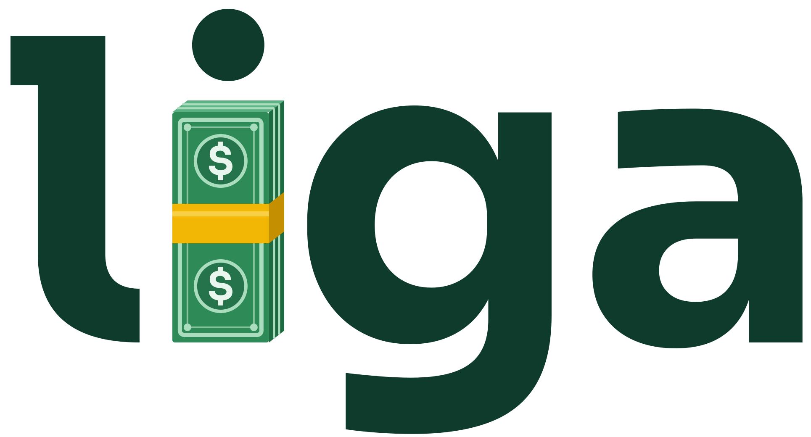

# Identidade visual do Liga

> A liga é o elástico que segura o dinheiro organizado. E ligar é conectar: web, Telegram e áudio, tudo ligado no mesmo assistente.

## Logo

A palavra **liga** em minúsculas, na fonte Sora Bold convertida em desenho:
- o **"l"** termina numa curva para a direita, que leva o olhar até o maço;
- o **"i"** é um **maço de notas** em pé, com volume lateral, borda dupla e dois cifrões, envolvido por uma **liga amarela**;
- o pingo do "i" fica na cor das letras; o amarelo aparece só na liga.

Os arquivos são vetoriais e não dependem da fonte instalada.

## Arquivos

| Arquivo | Uso |
|---|---|
| `logo.svg` / `logo.png` | Logo para fundos claros (README, site, documentos) |
| `logo-negativo.svg` / `logo-negativo.png` | Logo para fundos escuros |
| `icone.svg` | Ícone do app: só o maço, em quadrado verde-escuro arredondado |
| `icone-claro.svg` | Ícone em fundo claro |
| `icone-512.png`, `icone-192.png` | Ícones do PWA (manifest) |
| `apple-touch-icon.png` | Ícone da tela inicial no iPhone (180 px) |
| `favicon.svg`, `favicon-32.png` | Favicon do site |

Na fase 0, os arquivos de ícone e favicon são copiados para `web/public/`. O ícone também serve de foto de perfil do bot no Telegram.

## Paleta

| Nome | Hex | Uso |
|---|---|---|
| Verde Liga | `#0E3B2C` | Base, texto, fundo escuro |
| Verde nota | `#2E8B57` | Maço, gráficos de entrada |
| Amarelo liga | `#F2B705` | Destaque, botões principais |
| Creme | `#FAF7EF` | Fundo claro |
| Verde claro | `#A9DDBD` | Detalhes, estados suaves |
| Texto secundário | `#3D5A4E` | Legendas e textos de apoio |

## Tipografia

**Sora** (Google Fonts), geométrica e amigável. Títulos em 700, texto em 400 e 500.

## Regras de uso

- Não distorcer, girar nem mudar as cores da logo.
- Usar `logo.svg` em fundo claro e `logo-negativo.svg` em fundo escuro.
- Abaixo de 64 px, usar o ícone (só o maço), nunca a palavra inteira.
